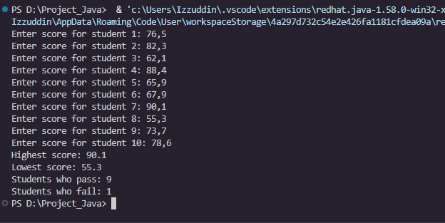
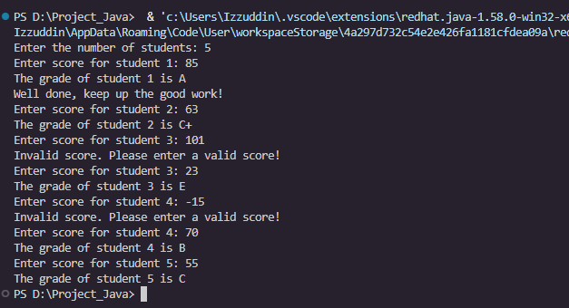
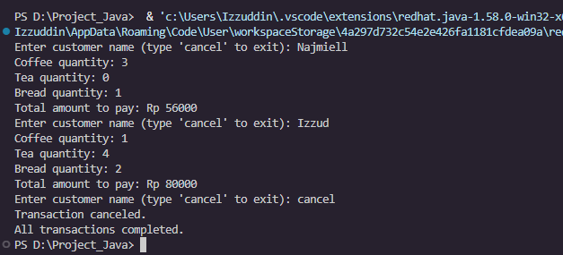
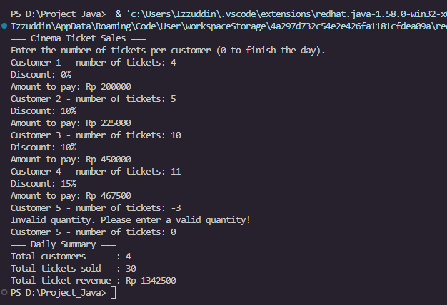
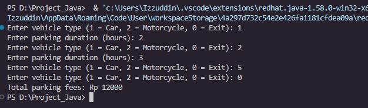

# JOBSHEET 7 - PERULANGAN 1

**Identitas Mahasiswa:**
* **Nama:** Muhammad Izzuddin Nur N.
* **NIM:** 264107020245
* **Kelas / No. Presensi:** 1I / 22

---

## 1: TUJUAN PRAKTIKUM

1. Mahasiswa mampu menjelaskan sintaks penulisan program perulangan (`for`, `while`, dan `do-while`).
2. Mahasiswa mampu mengimplementasikan flowchart perulangan menggunakan bahasa pemrograman Java.

---

## 2: HASIL PERCOBAAN & ANALISIS

### 2.1 Percobaan 1: Studi Kasus Nilai Mahasiswa di SIAKAD – FOR Loop

Program membaca nilai kuis 10 mahasiswa dengan `for`, lalu menampilkan nilai tertinggi, terendah, dan jumlah mahasiswa lulus/tidak lulus (batas 60).

#### 2.1.1 Kode Program Java
```java
// SiakadFor22.java
import java.util.Scanner;

public class SiakadFor22 {
    public static void main(String[] args) {
        Scanner sc = new Scanner(System.in);

        double score, highest = 0, lowest = 100;
        int passCount = 0, failCount = 0; // Pertanyaan 4: hitung lulus & tidak lulus

        for (int i = 1; i <= 10; i++) {
            System.out.print("Enter score for student " + i + ": ");
            score = sc.nextDouble();
            if (score > highest) {
                highest = score;
            }
            if (score < lowest) {
                lowest = score;
            }
            // Passing threshold: minimum score 60
            if (score >= 60) {
                passCount++;
            } else {
                failCount++;
            }
        }

        System.out.println("Highest score: " + highest);
        System.out.println("Lowest score: " + lowest);
        System.out.println("Students who pass: " + passCount);
        System.out.println("Students who fail: " + failCount);

        sc.close();
    }
}
```

#### 2.1.2 Hasil Running / Screenshot Output



```
Enter score for student 1: 76.5
Enter score for student 2: 82.3
Enter score for student 3: 62.1
Enter score for student 4: 88.4
Enter score for student 5: 65.9
Enter score for student 6: 67.9
Enter score for student 7: 90.1
Enter score for student 8: 55.3
Enter score for student 9: 73.7
Enter score for student 10: 78.6
Highest score: 90.1
Lowest score: 55.3
Students who pass: 9
Students who fail: 1
```

#### 2.1.3 Jawaban Pertanyaan
* **Pertanyaan 1:** Identifikasi komponen FOR loop pada kode Percobaan 1.
  * **Jawab:** `for (int i = 1; i <= 10; i++) { ... }`

    | Komponen | Kode | Keterangan |
    | :--- | :--- | :--- |
    | Inisialisasi | `int i = 1` | Nilai awal penghitung, dijalankan sekali. |
    | Kondisi | `i <= 10` | Dicek sebelum tiap iterasi. |
    | Update | `i++` | Dijalankan setelah badan loop. |
    | Badan loop | `{ ... }` | Input nilai, cek tertinggi dan terendah. |
* **Pertanyaan 2:** Mengapa `highest` diinisialisasi 0 dan `lowest` 100? Apa yang terjadi jika dibalik?
  * **Jawab:** Nilai berada di rentang 0–100, sehingga nilai pertama selalu bisa menggantikan nilai awal. Jika dibalik, `score > 100` dan `score < 0` tidak pernah benar, sehingga hasilnya selalu 100 dan 0.
* **Pertanyaan 3:** Jelaskan fungsi dan alur potongan kode `if (score > highest) { highest = score; } if (score < lowest) { lowest = score; }`.
  * **Jawab:** Mencari nilai maksimum dan minimum. Jika `score > highest`, `highest` diganti `score`. Jika `score < lowest`, `lowest` diganti `score`. Kedua `if` terpisah, jadi keduanya selalu dicek.
* **Pertanyaan 4:** Modifikasi program untuk menghitung mahasiswa lulus dan tidak lulus (minimal 60).
  * **Jawab:** Tambahkan `passCount` dan `failCount`. Jika `score >= 60` maka `passCount++`, selain itu `failCount++`. (Kode 2.1.1, output 2.1.2)
* **Pertanyaan 5:** *Commit* dan *push* ke GitHub.
  * **Jawab:** Lihat bagian 2.4.

---

### 2.2 Percobaan 2: Studi Kasus Nilai Mahasiswa di SIAKAD – WHILE Loop

Program meminta jumlah mahasiswa, membaca nilai dengan `while`, mengabaikan nilai di luar 0–100 dengan `continue`, lalu mengonversi nilai valid menjadi nilai huruf.

#### 2.2.1 Kode Program Java
```java
// SiakadWhile22.java
import java.util.Scanner;

public class SiakadWhile22 {
    public static void main(String[] args) {
        Scanner sc = new Scanner(System.in);

        int score, studentCount, i = 0;

        System.out.print("Enter the number of students: ");
        studentCount = sc.nextInt();

        while (i < studentCount) {
            System.out.print("Enter score for student " + (i + 1) + ": ");
            score = sc.nextInt();

            if (score < 0 || score > 100) {
                System.out.println("Invalid score. Please enter a valid score!");
                continue;
            }

            if (score > 80 && score <= 100) {
                System.out.println("The grade of student " + (i + 1) + " is A");
                // Pertanyaan 4: pesan tambahan untuk nilai A
                System.out.println("Well done, keep up the good work!");
            } else if (score > 73 && score <= 80) {
                System.out.println("The grade of student " + (i + 1) + " is B+");
            } else if (score > 65 && score <= 73) {
                System.out.println("The grade of student " + (i + 1) + " is B");
            } else if (score > 60 && score <= 65) {
                System.out.println("The grade of student " + (i + 1) + " is C+");
            } else if (score > 50 && score <= 60) {
                System.out.println("The grade of student " + (i + 1) + " is C");
            } else if (score > 39 && score <= 50) {
                System.out.println("The grade of student " + (i + 1) + " is D");
            } else {
                System.out.println("The grade of student " + (i + 1) + " is E");
            }
            i++;
        }

        sc.close();
    }
}
```

#### 2.2.2 Hasil Running / Screenshot Output



```
Enter the number of students: 5
Enter score for student 1: 85
The grade of student 1 is A
Well done, keep up the good work!
Enter score for student 2: 63
The grade of student 2 is C+
Enter score for student 3: 101
Invalid score. Please enter a valid score!
Enter score for student 3: 23
The grade of student 3 is E
Enter score for student 4: -15
Invalid score. Please enter a valid score!
Enter score for student 4: 70
The grade of student 4 is B
Enter score for student 5: 55
The grade of student 5 is C
```

#### 2.2.3 Jawaban Pertanyaan
* **Pertanyaan 1:** Arti dan tujuan `if (score < 0 || score > 100) { ... continue; }`.
  * **Jawab:**
    * **a. `score < 0 || score > 100`:** Operator OR bernilai `true` jika nilai di luar rentang 0–100, sehingga mendeteksi input tidak valid.
    * **b. `continue`:** Melewati sisa badan loop dan kembali ke kondisi `while`. `i++` terlewati, sehingga program meminta nilai mahasiswa yang sama lagi.
* **Pertanyaan 2:** Mengapa `i++` ditulis di akhir loop? Apa yang terjadi jika di awal?
  * **Jawab:** Agar hitungan naik hanya setelah nilai valid diproses. Jika di awal, input tidak valid tetap terhitung, jumlah data valid kurang dari `studentCount`, dan nomor mahasiswa `(i + 1)` bergeser.
* **Pertanyaan 3:** Jika jumlah mahasiswa 19, berapa kali loop dijalankan?
  * **Jawab:** 19 kali jika semua input valid. Setiap input tidak valid menambah satu putaran (total = 19 + jumlah input tidak valid).
* **Pertanyaan 4:** Tampilkan pesan "Well done, keep up the good work!" untuk nilai A.
  * **Jawab:** Tambahkan `System.out.println("Well done, keep up the good work!");` di dalam blok `if (score > 80 && score <= 100)`. (Kode 2.2.1, output 2.2.2)
* **Pertanyaan 5:** *Commit* dan *push* ke GitHub.
  * **Jawab:** Lihat bagian 2.4.

---

### 2.3 Percobaan 3: Studi Kasus Transaksi Kafe – DO-WHILE Loop

Program memproses transaksi kafe (kopi Rp 12.000, teh Rp 7.000, roti Rp 20.000) dengan `do-while` berkondisi `true`. Perulangan berhenti dengan `break` saat kasir mengetik "cancel".

#### 2.3.1 Kode Program Java
```java
// CafeDoWhile22.java
import java.util.Scanner;

public class CafeDoWhile22 {
    public static void main(String[] args) {
        Scanner sc = new Scanner(System.in);

        int coffee, tea, bread, totalPrice;
        String customerName;
        int coffeePrice = 12000, teaPrice = 7000, breadPrice = 20000;

        do {
            System.out.print("Enter customer name (type 'cancel' to exit): ");
            customerName = sc.nextLine();
            if (customerName.equalsIgnoreCase("cancel")) {
                System.out.println("Transaction canceled.");
                break;
            }
            System.out.print("Coffee quantity: ");
            coffee = sc.nextInt();
            System.out.print("Tea quantity: ");
            tea = sc.nextInt();
            System.out.print("Bread quantity: ");
            bread = sc.nextInt();
            totalPrice = (coffee * coffeePrice) + (tea * teaPrice) + (bread * breadPrice);
            System.out.println("Total amount to pay: Rp " + totalPrice);
            sc.nextLine(); // clear newline from the input buffer
        } while (true);

        System.out.println("All transactions completed.");

        sc.close();
    }
}
```

#### 2.3.2 Hasil Running / Screenshot Output



```
Enter customer name (type 'cancel' to exit): Rena
Coffee quantity: 3
Tea quantity: 0
Bread quantity: 1
Total amount to pay: Rp 56000
Enter customer name (type 'cancel' to exit): Yuni
Coffee quantity: 1
Tea quantity: 4
Bread quantity: 2
Total amount to pay: Rp 80000
Enter customer name (type 'cancel' to exit): CANCEL
Transaction canceled.
All transactions completed.
```

#### 2.3.3 Jawaban Pertanyaan
* **Pertanyaan 1:** Jika nama pelanggan pertama "cancel", berapa kali loop dieksekusi?
  * **Jawab:** 1 kali. Badan loop berjalan dulu, lalu `break` keluar saat "cancel" terdeteksi.
* **Pertanyaan 2:** Kondisi berhenti pada DO-WHILE ini?
  * **Jawab:** Kasir mengetik "cancel" (tanpa membedakan huruf besar/kecil karena `equalsIgnoreCase`), lalu `break` menghentikan loop.
* **Pertanyaan 3:** Fungsi nilai `true` pada kondisi DO-WHILE?
  * **Jawab:** Membuat loop berulang tanpa batas untuk jumlah pelanggan yang tidak diketahui. Penghentiannya lewat `break`.
* **Pertanyaan 4:** Mengapa loop tetap berjalan tanpa inisialisasi dan update?
  * **Jawab:** DO-WHILE hanya mewajibkan kondisi. Jumlah putaran ditentukan input pengguna dan `break`, bukan variabel penghitung.

---

### 2.4 Bukti Commit dan Push ke GitHub

Repository: `programming-fundamentals-jobsheet7`

> 📸 **SCREENSHOT 4 – Repository GitHub**
> **Yang di-screenshot:** Halaman repository `programming-fundamentals-jobsheet7` di GitHub yang menampilkan daftar file (`SiakadFor22.java`, `SiakadWhile22.java`, `CafeDoWhile22.java`, `tugas1TiketBioskop22.java`, `tugas2ParkirFlowchart22.java`) beserta pesan commit terakhir.
> **Simpan sebagai:** `images/github1.png`


> 📸 **SCREENSHOT 5 – Riwayat Commit**
> **Yang di-screenshot:** Halaman *Commits* repository tersebut (atau output `git log --oneline` di terminal) yang menunjukkan riwayat commit tiap percobaan.
> **Simpan sebagai:** `images/github2.png`


---

## 3: TUGAS MANDIRI

- [x] **Tugas 1:** Program penjualan tiket bioskop dengan diskon bertingkat (`tugas1TiketBioskop22.java`).
- [x] **Tugas 2:** Implementasi flowchart tarif parkir ke program Java (`tugas2ParkirFlowchart22.java`).

### 3.1 Implementasi Kode Tugas

**Tugas 1 - Penjualan Tiket Bioskop**

Harga tiket Rp 50.000. Diskon 10% untuk lebih dari 4 tiket dan 15% untuk lebih dari 10 tiket. Jumlah negatif diabaikan dengan `continue`. Input `0` mengakhiri penjualan dengan `break`, lalu program menampilkan total tiket dan pendapatan.

```java
// tugas1TiketBioskop22.java
import java.util.Scanner;

public class tugas1TiketBioskop22 {
    public static void main(String[] args) {
        Scanner sc = new Scanner(System.in);

        final int TICKET_PRICE = 50000;
        int quantity;
        int totalTickets = 0;
        double totalRevenue = 0;
        int customerNo = 0;

        System.out.println("=== Cinema Ticket Sales ===");
        System.out.println("Enter the number of tickets per customer (0 to finish the day).");

        while (true) {
            System.out.print("Customer " + (customerNo + 1) + " - number of tickets: ");
            quantity = sc.nextInt();

            // Invalid input (negative): ignore and ask again
            if (quantity < 0) {
                System.out.println("Invalid quantity. Please enter a valid quantity!");
                continue;
            }

            // 0 means no more customers
            if (quantity == 0) {
                break;
            }

            double discount = 0;
            if (quantity > 10) {
                discount = 0.15;
            } else if (quantity > 4) {
                discount = 0.10;
            }

            double price = quantity * TICKET_PRICE * (1 - discount);
            System.out.println("Discount: " + (int) (discount * 100) + "%");
            System.out.println("Amount to pay: Rp " + (long) price);

            totalTickets += quantity;
            totalRevenue += price;
            customerNo++;
        }

        System.out.println("=== Daily Summary ===");
        System.out.println("Total customers      : " + customerNo);
        System.out.println("Total tickets sold   : " + totalTickets);
        System.out.println("Total ticket revenue : Rp " + (long) totalRevenue);

        sc.close();
    }
}
```

Skenario pengujian Tugas 1:

| No | Input tiket | Diskon | Jumlah bayar | Keterangan |
| :---: | :---: | :---: | :---: | :--- |
| 1 | `4` | 0% | Rp 200000 | Belum mendapat diskon |
| 2 | `5` | 10% | Rp 225000 | Lebih dari 4 tiket |
| 3 | `10` | 10% | Rp 450000 | Batas atas diskon 10% |
| 4 | `11` | 15% | Rp 467500 | Lebih dari 10 tiket |
| 5 | `-3` | - | - | Tidak valid, diminta input ulang |
| 6 | `0` | - | - | Program berakhir, tampil ringkasan |

Ringkasan: 4 pelanggan, 30 tiket, pendapatan Rp 1342500.

Hasil running Tugas 1



```
=== Cinema Ticket Sales ===
Enter the number of tickets per customer (0 to finish the day).
Customer 1 - number of tickets: 4
Discount: 0%
Amount to pay: Rp 200000
Customer 2 - number of tickets: 5
Discount: 10%
Amount to pay: Rp 225000
Customer 3 - number of tickets: 10
Discount: 10%
Amount to pay: Rp 450000
Customer 4 - number of tickets: 11
Discount: 15%
Amount to pay: Rp 467500
Customer 5 - number of tickets: -3
Invalid quantity. Please enter a valid quantity!
Customer 5 - number of tickets: 0
=== Daily Summary ===
Total customers      : 4
Total tickets sold   : 30
Total ticket revenue : Rp 1342500
```

**Tugas 2 - Implementasi Flowchart Tarif Parkir**

Tarif mobil Rp 3.000/jam dan motor Rp 2.000/jam. Jenis `1` = mobil, `2` = motor, `0` = keluar. Input selain 0, 1, 2 diabaikan.

```java
// tugas2ParkirFlowchart22.java
import java.util.Scanner;

public class tugas2ParkirFlowchart22 {
    public static void main(String[] args) {
        Scanner sc = new Scanner(System.in);

        // Initialize variables: type, duration, total = 0
        int type, duration, total = 0;

        do {
            System.out.print("Enter vehicle type (1 = Car, 2 = Motorcycle, 0 = Exit): ");
            type = sc.nextInt();

            if (type == 1 || type == 2) {
                System.out.print("Enter parking duration (hours): ");
                duration = sc.nextInt();

                if (type == 1) {
                    total += duration * 3000; // car: Rp 3,000 per hour
                } else {
                    total += duration * 2000; // motorcycle: Rp 2,000 per hour
                }
            }
        } while (type != 0);

        System.out.println("Total parking fees: Rp " + total);

        sc.close();
    }
}
```

Skenario pengujian Tugas 2:

| No | Jenis kendaraan | Durasi | Perhitungan | Total berjalan |
| :---: | :---: | :---: | :--- | :---: |
| 1 | `1` (mobil) | `2` | 2 × 3000 = 6000 | Rp 6000 |
| 2 | `2` (motor) | `3` | 3 × 2000 = 6000 | Rp 12000 |
| 3 | `5` (tidak valid) | - | Diabaikan | Rp 12000 |
| 4 | `0` (keluar) | - | Loop berhenti | Rp 12000 |

Hasil running Tugas 2



```
Enter vehicle type (1 = Car, 2 = Motorcycle, 0 = Exit): 1
Enter parking duration (hours): 2
Enter vehicle type (1 = Car, 2 = Motorcycle, 0 = Exit): 2
Enter parking duration (hours): 3
Enter vehicle type (1 = Car, 2 = Motorcycle, 0 = Exit): 5
Enter vehicle type (1 = Car, 2 = Motorcycle, 0 = Exit): 0
Total parking fees: Rp 12000
```

---

## 4: KESIMPULAN

Perulangan `for` dipakai saat jumlah pengulangan diketahui, `while` saat pengulangan bergantung pada kondisi atau input, dan `do-while` saat badan loop harus berjalan minimal sekali. `break` menghentikan loop dan `continue` melewati sisa iterasi, sehingga flowchart dapat diterjemahkan menjadi program Java.